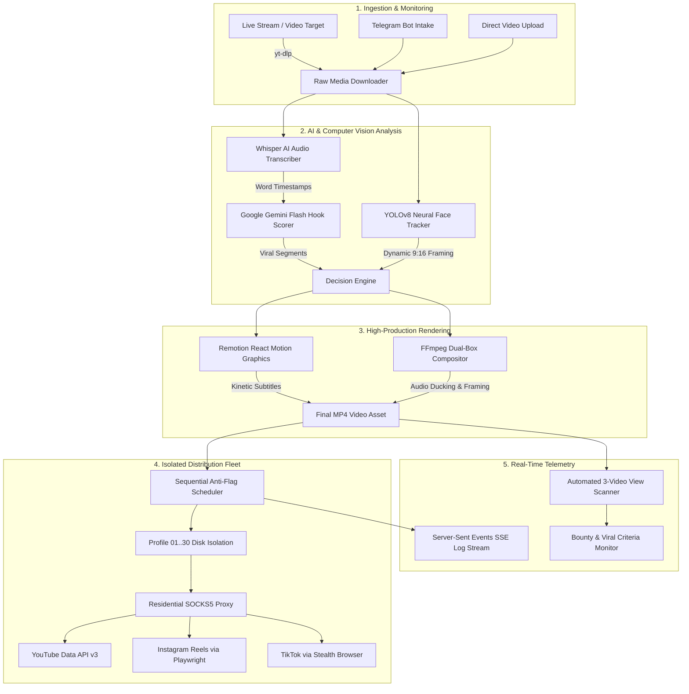

# GOING MERRY™ — AUTONOMOUS FLEET COMMAND

[](https://www.python.org/)
[]()
[]()
[](https://www.docker.com/)

**GOING MERRY™** is an autonomous, cloud-native video production and distributed multi-account social publishing engine. Designed for high-volume content creators and media operations, the platform monitors live broadcasts, extracts viral moments with Whisper and LLM scoring, renders dynamic 9:16 vertical shorts using Remotion and FFmpeg, and distributes them across social platforms with physical disk-level session isolation.

---

## 🏛️ System Architecture



---

## ⚡ Core Operational Features

- **Physical Chrome Profile Isolation:** Up to 30 independent browser sessions stored in disk-isolated directories (`uploader_profiles/profile_N`), guaranteeing zero cookie overwrites and zero cross-account session contamination.
- **Remote Mobile noVNC Cloud Authentication:** Virtual display (`Xvfb`) rendered directly to mobile browsers via noVNC on port 8080. Enables operators to solve 2FA challenges and sign into Google accounts securely from a smartphone.
- **Residential SOCKS5 Network Gateway:** Integrated WiFi/residential proxy tunnel (`home_wifi_gateway.py`) preventing datacenter IP blacklisting across social media platforms.
- **Dynamic 9:16 Face Centering:** YOLOv8 face detection neural weights (`yolov8n-face.pt`) continuously track active speakers to keep subjects centered in vertical shorts.
- **Kinetic Animated Captions:** Millisecond-accurate animated subtitles rendered with React and Remotion, synced to Whisper word timestamps.
- **Anti-Flag Sequential Scheduler:** Automated 20–30 minute humanized jitter delays between queued uploads to avoid platform velocity triggers.
- **Direct View Telemetry Auditing:** Automatic `yt-dlp` scraping of the last 3 published videos per node to verify real performance and calculate viral criteria bounties.

---

## 📁 Repository Structure

```
.
├── web_app/                   # Flask Command Center & Management Dashboard
│   ├── app.py                 # Application factory & database initialization
│   ├── models.py              # SQLAlchemy models (User, Clip, SocialAccount, etc.)
│   ├── routes/
│   │   ├── auth.py            # Passcode authentication & public landing route
│   │   ├── dashboard.py       # Fleet telemetry, stats, and view scanner
│   │   ├── clips.py           # Video dispatches, manual uploads, and status
│   │   ├── influencers.py     # Channel tracking and stream target registry
│   │   ├── platform_auth.py   # Multi-node OAuth & Playwright profile links
│   │   └── pipeline.py        # SSE log streaming & live process management
│   ├── static/                # Design system CSS (Michroma/Space Grotesk/JetBrains Mono)
│   └── templates/             # Jinja2 responsive templates (landing, dashboard, login)
│
├── clipper/                   # AI Video Processing & Publishing Pipeline
│   ├── core/                  # Modular processors (transcriber, face tracker, etc.)
│   ├── remotion/              # React/Remotion dynamic caption compositions
│   ├── uploader/              # YouTube OAuth worker, Playwright dispatchers, scheduler
│   └── utils/                 # Downloader, LLM routers, and media helpers
│
├── connect_youtube_studio.py  # Local browser profile linker for YouTube Studio
├── home_wifi_gateway.py       # SOCKS5 residential proxy tunnel manager
├── going_merry.py             # End-to-end command-line video pipeline
├── yolov8n-face.pt            # YOLOv8 face tracking neural weights
├── Dockerfile                 # Production Ubuntu Jammy + Playwright + Xvfb + noVNC
├── docker-compose.yml         # Cloud deployment specification (Ports 80 & 8080)
├── start_cloud.sh             # Cloud service bootstrapper (Xvfb, websockify, Flask)
└── requirements.txt           # Python production dependencies
```

---

## 🚀 Getting Started

### Prerequisites

- **Python:** 3.11+
- **Node.js:** 18+ & npm (required for Remotion subtitle rendering)
- **FFmpeg:** 6.x+ with `libx264` and `aac` codecs installed
- **Docker & Docker Compose:** (for containerized cloud deployment)
- **Google Chrome / Chromium:** (for Playwright browser automation)

### Local Environment Setup

1. **Clone the repository:**
   ```bash
   git clone https://github.com/Madalior/ai-video-automation.git
   cd ai-video-automation
   ```

2. **Create and activate a virtual environment:**
   ```bash
   python -m venv .venv
   # Windows:
   .venv\Scripts\activate
   # Linux/macOS:
   source .venv/bin/activate
   ```

3. **Install Python dependencies:**
   ```bash
   pip install --upgrade pip
   pip install -r requirements.txt
   playwright install chromium
   ```

4. **Install Remotion dependencies:**
   ```bash
   cd clipper/remotion
   npm install
   cd ../..
   ```

5. **Configure environment variables:**
   Create a `.env` file in the root directory:
   ```ini
   SECRET_KEY=your_secure_flask_secret_key
   GEMINI_API_KEY=your_google_gemini_api_key
   OPERATOR_PASSCODE=your_command_center_passcode
   SOCKS5_PROXY=socks5://127.0.0.1:1080
   CRITERIA_VIEWS=1000
   PORT=5000
   ```

6. **Initialize database and start development server:**
   ```bash
   python -m web_app.app
   ```
   Open your browser at `http://127.0.0.1:5000`.

---

## 🐳 Production Cloud Deployment (Docker)

The production stack runs on Ubuntu 22.04 Jammy with virtual Xvfb display and noVNC streaming.

```bash
# 1. Build and launch container in background
docker compose up -d --build

# 2. Inspect logs
docker compose logs -f

# 3. Access web services
# - Web Dashboard:  http://<SERVER_IP>:80 (or custom domain)
# - noVNC Display:   http://<SERVER_IP>:8080
```

---

## ⚙️ Configuration Reference

| Environment Variable | Description | Default |
|----------------------|-------------|---------|
| `SECRET_KEY` | Flask session cryptographic key | `dev-secret-key-change-me` |
| `GEMINI_API_KEY` | Google Gemini API key for hook scoring | *Required for LLM scoring* |
| `OPERATOR_PASSCODE` | Master gate passcode for single-operator access | `Booma@07` |
| `SOCKS5_PROXY` | Residential SOCKS5 proxy URL for upload masking | `None` |
| `CRITERIA_VIEWS` | Minimum view threshold to flag viral bounty hits | `1000` |
| `FLASK_ENV` | Environment mode (`production` / `development`) | `production` |

---

## 🔧 Operational Troubleshooting

1. **Port 80 / 5000 Already in Use:**
   - Check if an existing system Nginx or Apache service is binding port 80: `sudo lsof -i :80` or `sudo netstat -tlpn`.
   - Adjust port mapping in `docker-compose.yml` (e.g., `"5000:5000"`).

2. **Google OAuth "Redirect URI Mismatch":**
   - Ensure `client_secrets.json` has `http://localhost:<PORT>/` in its authorized redirect URIs.
   - For cloud operation, complete authentication via the built-in mobile noVNC console at port 8080.

3. **FFmpeg / Remotion Subtitle Render Timeout:**
   - Verify Node.js is installed and `clipper/remotion/node_modules` exists.
   - Test rendering standalone: `node clipper/remotion/render.js --help`.

4. **Playwright Chromium Launch Error on Linux:**
   - Run `playwright install --with-deps chromium` to ensure system graphics libraries (`libgbm1`, `libnss3`) are installed.

---

## 🗺️ Roadmap & Project Status

- [x] Single-operator command center dashboard
- [x] Local Whisper speech-to-text with word timestamp extraction
- [x] YOLOv8 face detection dynamic 9:16 vertical crop
- [x] Remotion kinetic caption rendering
- [x] YouTube Data API v3 OAuth multi-account manager
- [x] 30-node disk-isolated browser profile architecture
- [x] Real-time SSE telemetry logs and yt-dlp view scraper
- [ ] Multi-operator RBAC role management
- [ ] Direct TikTok / Instagram Official API Graph integration
- [ ] Distributed Celery / Redis task queue for multi-node GPU clustering

---

## 📄 License & Attribution

GOING MERRY™ is proprietary software. All rights reserved.  
Contact: `founder@sarkaricalc.me`
