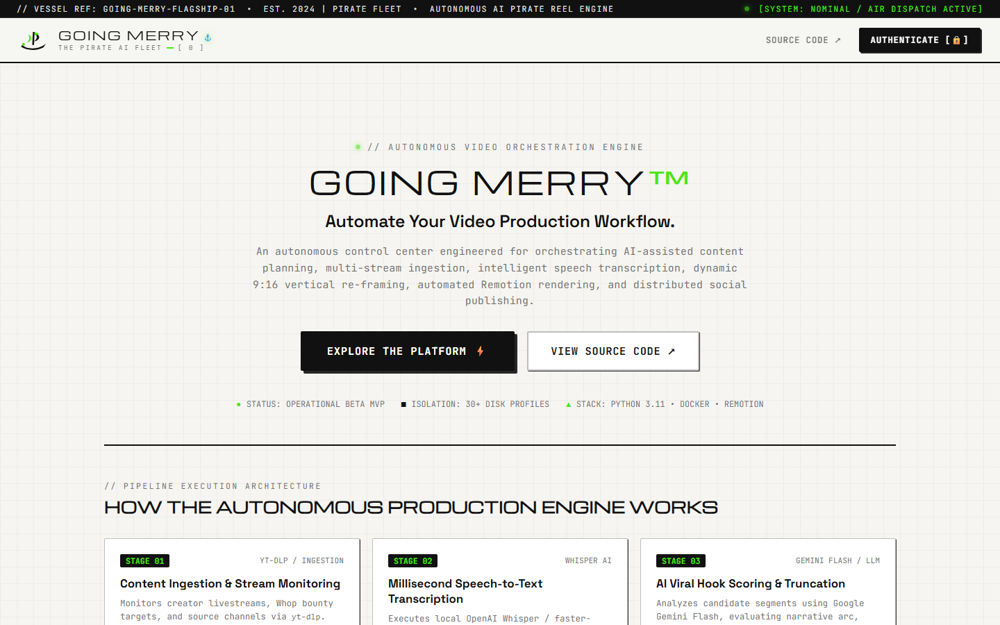
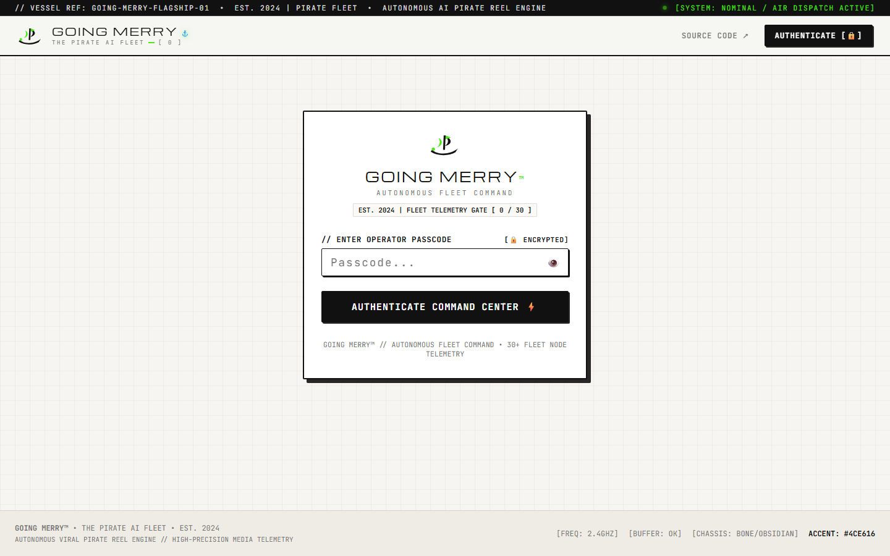
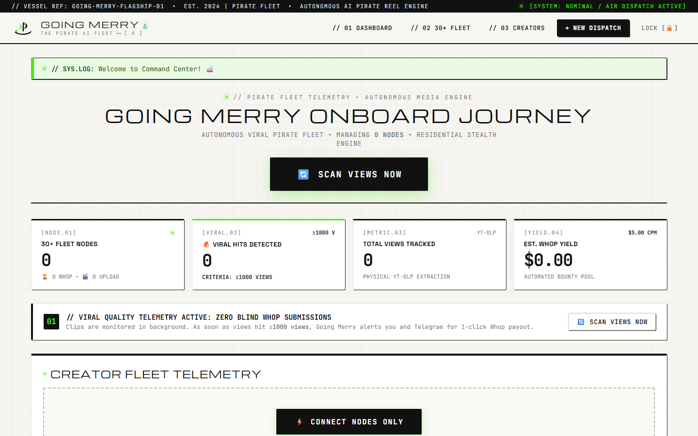
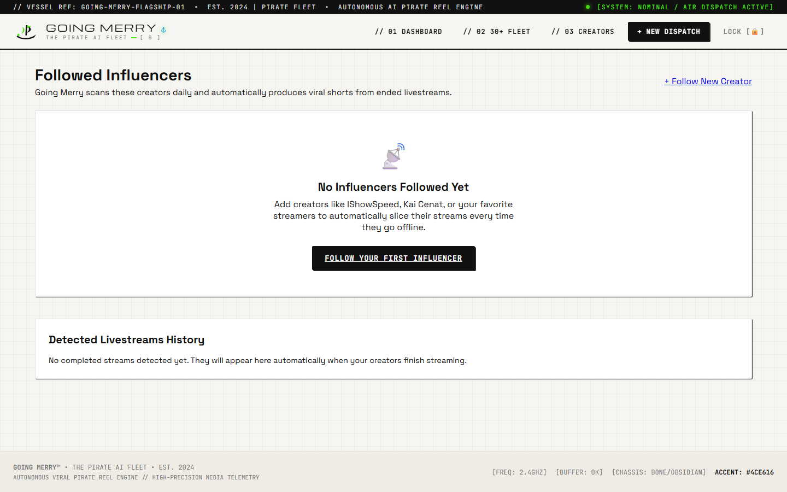
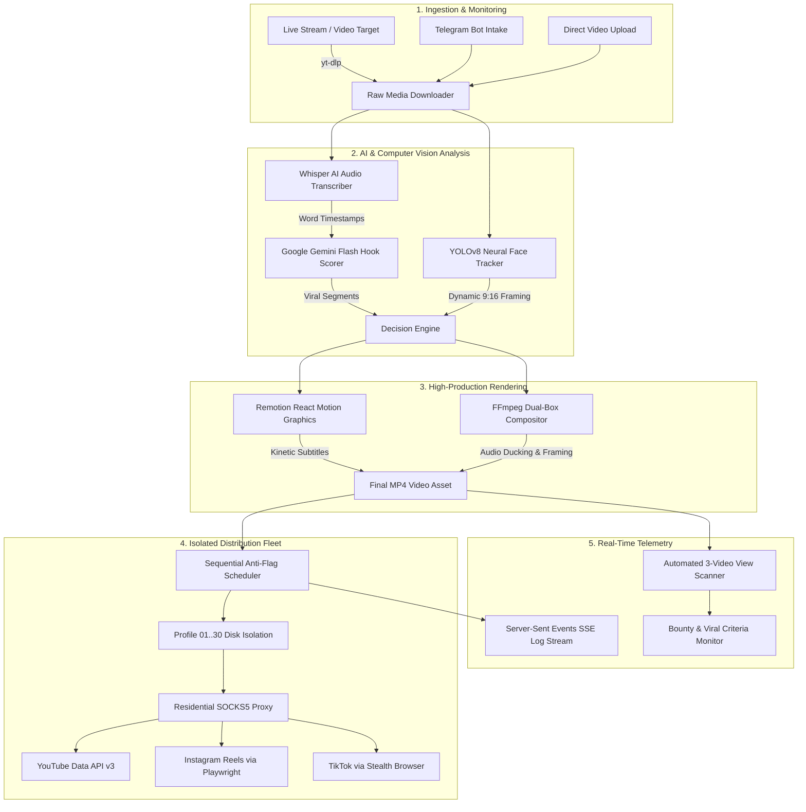

# GOING MERRY™ — AUTONOMOUS FLEET COMMAND

[](https://www.python.org/)
[]()
[](https://www.docker.com/)
[]()

**GOING MERRY™** is an autonomous, cloud-native video production and distributed multi-account social publishing engine. Designed for high-volume content creators, media studios, and autonomous clipping operations, the platform monitors live broadcasts, extracts viral moments with Whisper AI and LLM scoring, renders dynamic 9:16 vertical shorts using Remotion and FFmpeg, and distributes them across social platforms with physical disk-level session isolation.

---

## 📸 Application Showcase

| Public Product Landing Page | Operator Authentication Gateway |
|:---:|:---:|
|  |  |
| *Public landing introducing the autonomous video orchestration pipeline.* | *Single-operator encrypted telemetry authentication gate.* |

| 30+ Fleet Telemetry Dashboard | Creators & Ingestion Management |
|:---:|:---:|
|  |  |
| *Live node status, criteria view scanner, and bounty performance tracking.* | *Automated stream monitors, channel target registry, and ingest queues.* |

---

## 🏛️ System Architecture



---

## 🎬 The Seven-Stage Autonomous Pipeline

The core media production engine (`clipper/` & `going_merry.py`) operates as a deterministic 7-stage pipeline:

### 1. Ingestion & Stream Monitoring
- **Automated Source Tracking:** Actively polls YouTube livestreams, Whop campaign URLs, and Telegram channels via `yt-dlp`.
- **Intake Flexibility:** Ingests live broadcasts, scheduled streams, manual MP4 vault uploads, and mobile Telegram bot media dispatches.
- **Segment Buffering:** Automatically buffers video streams in high-throughput chunks without saturating server memory.

### 2. Audio Extraction & Speech-to-Text
- **Subprocess Audio Demux:** Extracts 16kHz mono audio tracks directly using FFmpeg filters.
- **Precision AI Transcription:** Dispatches audio to local OpenAI Whisper / `faster-whisper` models.
- **Word-Level Timestamps:** Produces word-level millisecond timing dictionaries required for frame-accurate kinetic subtitles.

### 3. AI Viral Hook Scoring & Truncation
- **Contextual Transcript Ingestion:** Transcripts are batched into sliding conversational windows.
- **LLM Evaluation:** Analyzed via Google Gemini Flash 1.5 (or Groq LLaMA) with specialized prompts scoring narrative arc, emotional tension, punchline delivery, and viewer retention probability.
- **Optimal Slice Selection:** Outputs start/stop timestamps isolating peak 30–60 second viral segments.

### 4. Computer Vision 9:16 Smart Framing
- **YOLOv8 Neural Detection:** Runs `yolov8n-face.pt` across input video frames to identify primary speakers.
- **Adaptive Centering:** Computes bounding box moving averages to eliminate jitter while keeping moving speakers centered in standard 9:16 (1080x1920) mobile viewport.
- **Dual-Box Split Screen:** Automatically composes gameplay/reaction footage with speaker camera boxes.

### 5. Kinetic Subtitles & Video Assembly
- **Remotion React Compositions:** Renders high-production kinetic animated subtitles (`clipper/remotion/`) synced to Whisper word timings.
- **Visual Stylings:** Applies custom typography, vibrant word highlights, drop shadows, and glow animations.
- **FFmpeg Compositing:** Merges video crops, Remotion alpha channels, and audio ducking (lowering background music during speech) into final MP4 deliverables.

### 6. Multi-Channel Isolated Distribution
- **Physical Disk Isolation:** Allocates a dedicated Chrome profile directory (`uploader_profiles/profile_N`) per creator node to prevent cookie collisions and session invalidation.
- **Official & Stealth Dispatch:** Uploads via YouTube Data API v3 OAuth alongside Playwright stealth automation for Instagram Reels and TikTok.
- **Residential IP Masking:** Routes requests through home WiFi SOCKS5 proxy tunnels (`home_wifi_gateway.py`), avoiding datacenter IP bans.
- **Human Jitter Timing:** Schedules posts sequentially with randomized 20–30 minute delays.

### 7. Telemetry Streaming & View Auditing
- **Real-Time Logs:** Streams terminal subprocess logs directly to web browsers via Server-Sent Events (SSE).
- **Physical View Extraction:** "SCAN VIEWS NOW" command invokes automated `yt-dlp` scraping on the last 3 published videos per connected channel.
- **Viral Bounty Auditing:** Evaluates real view counts against minimum criteria (e.g. $\ge 1,000$ views) to identify verified payout opportunities.

---

## ⚡ Implemented Features & Technical Status

| Feature Module | Implementation Status | Tech Stack / Architecture |
| :--- | :---: | :--- |
| **Passcode-Gated Dashboard** | ✅ Implemented | Flask-Login, Flask-Bcrypt, single-operator console |
| **Public Product Landing Page** | ✅ Implemented | Responsive Jinja2 template (`landing.html`), SEO metadata |
| **Whisper Audio Transcription** | ✅ Implemented | Local OpenAI Whisper / faster-whisper |
| **Gemini Flash Hook Scorer** | ✅ Implemented | Google Generative AI SDK, JSON structured output |
| **YOLOv8 Face Tracking** | ✅ Implemented | Ultralytics YOLOv8 (`yolov8n-face.pt`), OpenCV |
| **Remotion Motion Captions** | ✅ Implemented | React, TypeScript, Remotion 4.x, Node.js |
| **FFmpeg Dynamic Compositor** | ✅ Implemented | FFmpeg 6.x hardware-accelerated pipeline |
| **30-Node Profile Isolation** | ✅ Implemented | Dedicated filesystem profiles (`uploader_profiles/`) |
| **YouTube API v3 Dispatcher** | ✅ Implemented | Google API Client OAuth 2.0 flow |
| **Mobile noVNC Virtual Display** | ✅ Implemented | Xvfb virtual framebuffer + noVNC (Port 8080) |
| **Residential SOCKS5 Gateway** | ✅ Implemented | Python SOCKS5 proxy tunnel (`home_wifi_gateway.py`) |
| **Automated View Telemetry** | ✅ Implemented | Direct yt-dlp metadata scraping of 3 most recent videos |
| **Multi-Operator Team RBAC** | 📋 Roadmap | Planned for v2.0 release |
| **Direct TikTok Official API** | 📋 Roadmap | Awaiting enterprise partner verification |

---

## 🔒 Security & Credential Protection

- **Zero Credentials in Git:** All secrets, `.pem` SSH keys, OAuth tokens, and `.env` files are strictly excluded via [`.gitignore`](.gitignore).
- **Automated Security Audit:** Verified with automated regex scanners to ensure zero API keys, private keys, or passwords exist in the source tree.
- **Sandboxed Execution:** Upload sessions and automated browser contexts run inside sandboxed system directories.

---

## 📁 Repository Structure

```
.
├── docs/
│   └── screenshots/           # Live application screenshots
│       ├── landing_page.png
│       ├── command_center_login.png
│       ├── fleet_dashboard.png
│       └── creators_management.png
│
├── web_app/                   # Flask Command Center & Management Dashboard
│   ├── app.py                 # Application factory & database initialization
│   ├── models.py              # SQLAlchemy models (User, Clip, SocialAccount, etc.)
│   ├── routes/
│   │   ├── auth.py            # Passcode authentication & public landing route
│   │   ├── dashboard.py       # Fleet telemetry, stats, and view scanner
│   │   ├── clips.py           # Video dispatches, manual uploads, and status
│   │   ├── influencers.py     # Channel tracking and stream target registry
│   │   ├── platform_auth.py   # Multi-node OAuth & Playwright profile links
│   │   └── pipeline.py        # SSE log streaming & live process management
│   ├── static/                # Design system CSS (Michroma/Space Grotesk/JetBrains Mono)
│   └── templates/             # Responsive templates (landing.html, dashboard.html, login.html)
│
├── clipper/                   # AI Video Processing & Publishing Pipeline
│   ├── core/                  # Modular processors (transcriber, face tracker, caption burner)
│   ├── remotion/              # React/Remotion dynamic caption compositions
│   ├── uploader/              # YouTube OAuth worker, Playwright dispatchers, scheduler
│   └── utils/                 # Downloader, LLM routers, and media helpers
│
├── connect_youtube_studio.py  # Local browser profile linker for YouTube Studio
├── home_wifi_gateway.py       # SOCKS5 residential proxy tunnel manager
├── going_merry.py             # End-to-end command-line video pipeline
├── run_tests.py               # Comprehensive modular testing suite
├── yolov8n-face.pt            # YOLOv8 face tracking neural weights
├── Dockerfile                 # Production Ubuntu Jammy + Playwright + Xvfb + noVNC
├── docker-compose.yml         # Cloud deployment specification (Ports 80 & 8080)
├── start_cloud.sh             # Cloud service bootstrapper (Xvfb, websockify, Flask)
└── requirements.txt           # Python production dependencies
```

---

## 🚀 Getting Started & Setup Instructions

### Prerequisites

- **Python:** 3.11+
- **Node.js:** 18+ & npm (required for Remotion subtitle rendering)
- **FFmpeg:** 6.x+ with `libx264` and `aac` codecs installed
- **Docker & Docker Compose:** (for containerized deployment)
- **Google Chrome / Chromium:** (for Playwright browser automation)

### Local Environment Setup

1. **Clone the repository:**
   ```bash
   git clone https://github.com/Madalior/ai-video-automation.git
   cd ai-video-automation
   ```

2. **Create and activate a virtual environment:**
   ```bash
   python -m venv .venv
   # Windows:
   .venv\Scripts\activate
   # Linux/macOS:
   source .venv/bin/activate
   ```

3. **Install Python dependencies & Playwright:**
   ```bash
   pip install --upgrade pip
   pip install -r requirements.txt
   playwright install chromium
   ```

4. **Install Remotion dependencies:**
   ```bash
   cd clipper/remotion
   npm install
   cd ../..
   ```

5. **Configure environment variables:**
   Create a `.env` file in the root directory (based on `.env.example`):
   ```ini
   SECRET_KEY=your_secure_flask_secret_key
   GEMINI_API_KEY=your_google_gemini_api_key
   OPERATOR_PASSCODE=Booma@07
   SOCKS5_PROXY=socks5://127.0.0.1:1080
   CRITERIA_VIEWS=1000
   PORT=5000
   ```

6. **Initialize database and start development server:**
   ```bash
   python -m web_app.app
   ```
   Open your browser at `http://127.0.0.1:5000`.

---

## 🐳 Production Cloud Deployment (Docker)

The production stack runs on Ubuntu 22.04 Jammy with virtual Xvfb display and noVNC streaming.

```bash
# 1. Build and launch container in background
docker compose up -d --build

# 2. Inspect logs
docker compose logs -f

# 3. Access web services
# - Web Dashboard:  http://<SERVER_IP>:80 (or https://app.sarkaricalc.me)
# - noVNC Display:   http://<SERVER_IP>:8080
```

---

## 🧪 Testing & Verification

Run the built-in test suite to verify pipeline subsystems:

```bash
# Test Whop campaign parsing and submitter logic:
python run_tests.py --test whop

# Run all modular subsystem checks:
python run_tests.py --all
```

---

## 📄 License & Attribution

GOING MERRY™ is proprietary software. All rights reserved.  
Contact: `founder@sarkaricalc.me`
